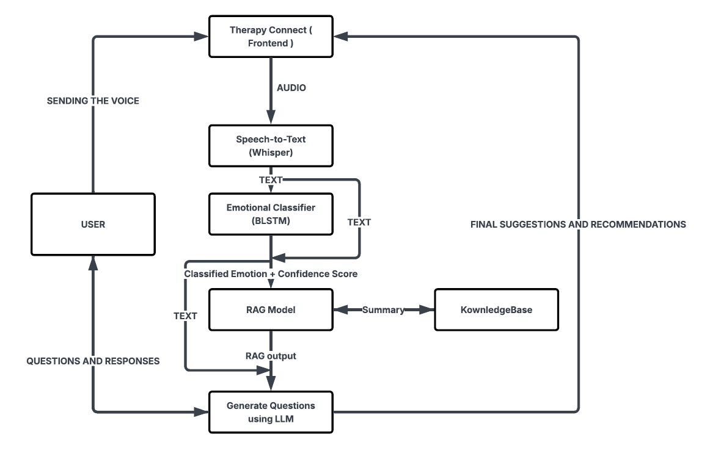

# Therapy Connect

Therapy Connect is an AI-powered interactive therapeutic assistant designed to provide an empathetic and supportive space for users to explore their thoughts and emotions.

The application combines speech recognition, emotion detection, Retrieval-Augmented Generation (RAG), and Large Language Models (LLMs) to understand user input and generate personalized, context-aware conversational responses.

## Project Preview

<p align="center">
  
</p>

## System Architecture & Data Flow

The application follows a multi-stage AI pipeline managed by a FastAPI backend, processing user audio through transcription, emotion analysis, knowledge retrieval, and response generation.

<p align="center">
  
</p>

## Key Features

- **Speech-to-Text:** Converts user audio into text using Whisper.
- **Emotion Detection:** Identifies primary and secondary emotions using a custom BiLSTM model.
- **Intelligent RAG:** Uses ChromaDB to retrieve relevant information from a specialized knowledge base.
- **Conversational AI:** Generates personalized responses and contextual follow-up questions using Gemini.
- **Interactive Dashboard:** Responsive interface with audio visualization and session management.
- **Session Summaries:** Downloadable JSON reports containing conversation details and AI analysis.

## Technology Stack

| Component | Technologies |
|---|---|
| Frontend | HTML, Tailwind CSS, JavaScript |
| Backend | Python, FastAPI |
| Speech Recognition | Whisper, FFmpeg |
| Emotion Detection | BiLSTM, TensorFlow/Keras |
| LLM | Google Gemini |
| RAG & Vector Database | ChromaDB |

## Project Structure

```text
Therapy_Connect/
├── components/
│   ├── ui/
│   ├── data/
│   │   └── knowledge_base_db/
│   ├── dev files/
│   │   ├── assets/
│   │   └── *.html
│   ├── models/
│   ├── pipeline_io/
│   └── services/
│       ├── emotion_service.py
│       ├── main_app.py
│       ├── rag_service.py
│       └── transcription_api.py
├── Application_Pictures/
├── .env
├── package.json
└── requirements.txt
```

## Installation & Execution

**1. Clone the repository**

```bash
git clone https://github.com/sahilkarande/Therapy_Connect.git
cd Therapy_Connect
```

**2. Create a virtual environment and install dependencies**

```bash
python -m venv venv
source venv/bin/activate  # Windows: venv\Scripts\activate
pip install -r requirements.txt
```

**3. Configure environment variables**

Create a `.env` file in the project root:

```env
GOOGLE_API_KEY=your_google_api_key
```

**4. Configure prerequisites**

- Install [FFmpeg](https://ffmpeg.org/download.html).
- Obtain the pre-trained BiLSTM model and tokenizer.
- Configure or generate the ChromaDB knowledge base.

**5. Start the backend**

```bash
cd components/services
uvicorn main_app:app --reload
```

Backend: `http://127.0.0.1:8000`

API Documentation: `http://127.0.0.1:8000/docs`

Open the frontend `index.html` using a browser or Live Server.

## Future Enhancements

- Secure user authentication and persistent session history.
- Advanced emotional analytics and visualizations.
- Real-time audio streaming and transcription.
- Cloud deployment and scalability improvements.

## Disclaimer

Therapy Connect is an experimental AI-powered conversational assistant. It is intended for emotional support and personal reflection and is not a substitute for professional mental health care, diagnosis, or treatment.
