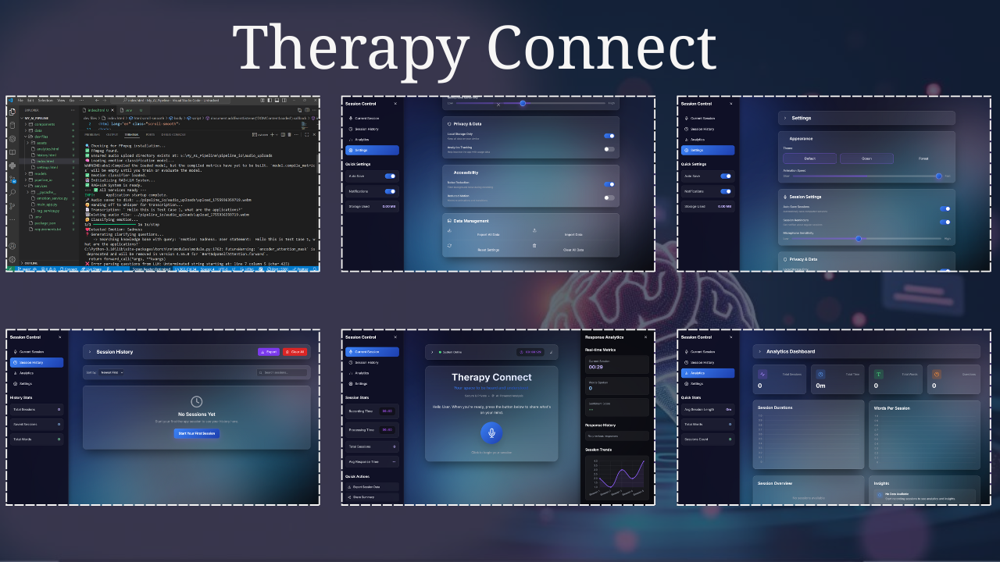

# Therapy Connect 🧠✨

Therapy Connect is an AI-powered interactive therapeutic assistant designed to provide an empathetic and understanding space for users to explore their thoughts. It's a full-stack web application featuring a multi-stage AI pipeline that listens, understands, and interacts in a deeply personalized and conversational manner.

# Drive Link
Visit Files: [https://drive.google.com/drive/folders/1S8QnxsFunuPhtRWAwy4UvDOt4jbhUc15?usp=sharing]

# 🎨 Frontend Design

For more project images, please open the [**Application_Pictures**](./Application_Pictures) folder.

# 🌊 Data Flow Diagram

The core logic resides within the FastAPI server. Here is a detailed breakdown of how data flows through the AI services during a user session.

# ✨ Key Features
- **End-to-End AI Pipeline**: A complete system processing raw audio through transcription, emotion analysis, and context-aware response generation.

- **Intelligent RAG System**: Utilizes Retrieval-Augmented Generation with a ChromaDB vector database to ground the LLM's responses in a specialized knowledge base, ensuring accuracy and relevance.

- **Dynamic Conversational AI**: Engages users in an interactive dialogue by generating clarifying questions based on their initial statement and emotional state.

- **Nuanced Emotion Analysis**: A custom BiLSTM model identifies both primary and secondary emotions for a deeper understanding of the user's state.

- **Interactive Web Interface**: A modern, responsive frontend built with HTML, Tailwind CSS, and JavaScript, featuring real-time audio visualization and dynamic state management.

- **Downloadable Summaries**: Users can download a complete summary of their session, including their responses and the AI's analysis, as a formatted JSON.

# 📂 Project Structure

<pre>
📁 MY_AI_PIPELINE
│
├── 📁 components
│   ├── 📁 ui
│   │   └── 📄 chart.js
│   │
│   ├── 📁 data
│   │   ├── 📁 knowledge_base_db
│   │   │   ├── 📁 04d86436-3734-4fc9-9d44-b594c2f64816
│   │   │   │   ├── 📄 data_level0.bin
│   │   │   │   ├── 📄 header.bin
│   │   │   │   ├── 📄 length.bin
│   │   │   │   └── 📄 link_lists.bin
│   │   │   │
│   │   │   ├── 📁 04d86436-3734-4fc9-9d44-b594c2f64816-20250728T061644Z-1-0
│   │   │   │   ├── 📄 data_level0.bin
│   │   │   │   ├── 📄 header.bin
│   │   │   │   ├── 📄 index_metadata.pickle
│   │   │   │   ├── 📄 length.bin
│   │   │   │   └── 📄 link_lists.bin
│   │   │   │
│   │   │   └── 📄 chroma.sqlite3
│   │   │
│   │   └── 📁 dev files
│   │       ├── 📁 assets
│   │       │   ├── 📁 css
│   │       │   │   └── 📄 style.css
│   │       │   └── 📁 javascript
│   │       │       ├── 📄 analytics.js
│   │       │       ├── 📄 app.js
│   │       │       ├── 📄 history.js
│   │       │       └── 📄 settings.js
│   │       │
│   │       ├── 📄 analytics.html
│   │       ├── 📄 history.html
│   │       ├── 📄 index.html
│   │       └── 📄 settings.html
│   │
│   ├── 📁 models
│   │   ├── 📄 BILSTM_model.h5
│   │   └── 📄 final_tokenizer.pkl
│   │
│   ├── 📁 pipeline_io
│   │   ├── 📁 audio_uploads
│   │   ├── 📁 stage1_transcriptions
│   │   │   ├── 📁 archive
│   │   │   ├── 📄 test.txt
│   │   │   └── 📄 transcription_20250725_071702_1753427822408.txt
│   │   │
│   │   └── 📄 index.html
│   │
│   └── 📁 services
│       ├── 📁 __pycache__
│       │   ├── 📄 emotion_service.cpython-310.pyc
│       │   ├── 📄 emotion_service.cpython-311.pyc
│       │   ├── 📄 main_api.cpython-311.pyc
│       │   ├── 📄 main_app.cpython-310.pyc
│       │   ├── 📄 main_app.cpython-311.pyc
│       │   ├── 📄 rag_service.cpython-310.pyc
│       │   ├── 📄 rag_service.cpython-311.pyc
│       │   ├── 📄 transcription_api.cpython-311.pyc
│       │   └── 📄 whisper.cpython-311.pyc
│       │
│       ├── 📄 emotion_service.py
│       ├── 📄 main_app.py
│       ├── 📄 rag_service.py
│       └── 📄 transcription_api.py
│
├── 📄 .env
├── 📄 package.json
└── 📄 requirements.txt
</pre>

# 🚀 Setup and Installation

Follow these steps to set up and run the project locally.

## Prerequisites

- Python 3.9+

- FFmpeg: Whisper requires FFmpeg to be installed on your system and accessible from the command line. You can download it from ffmpeg.org.

- Google API Key: You need a Google API key with the "Generative Language API" enabled to use Gemini Pro.

## Installation Steps

- Clone the repository:

  - git clone https://github.com/sahilkarande/Therapy_Connect
  - cd My_AI_Pipeline

- Create a virtual environment:

  - python -m venv venv
  - source venv/bin/activate  # On Windows: venv\Scripts\activate

- Install dependencies:

  - pip install -r requirements.txt

- Set up your environment variables:

  - Create a file named .env in the root directory of the project.

  - Add your Google API key to this file:

    - GOOGLE_API_KEY="your_google_api_key_here"
  

# ▶️ How to Run
1. Start the Backend Server:

  - Navigate to the services/ directory.

  - Run the following command in your terminal:

    - uvicorn main_app:app --reload

  - The server will start on http://127.0.0.1:8000.

2. Open the Frontend:

  - Navigate to the root directory of the project.
  
  - Open the index.html file in your web browser.

The application is now ready to use!

# 🔮 Future Scope

- **User Authentication**: Implement a user login system to save and track session history securely.

- **Analytics Dashboard**: Develop a dashboard to visualize emotional trends and session data over time.

- **Streaming Audio**: Upgrade from file uploads to real-time streaming audio transcription for a more fluid user experience.

- **Cloud Deployment**: Deploy the entire application to a cloud platform like Google Cloud Run or AWS for public access.

# NOTE

## 📄 Files Not Included in This Repository

Certain files and folders are intentionally excluded from this repository via .gitignore for efficiency, security, and best practices.

- /models/: This folder contains large, pre-trained machine learning model files (.h5, .pkl). They are ignored to keep the repository size small and prevent upload/download issues. You must acquire these models separately to run the project.

- /data/: This folder contains the ChromaDB vector database. It is ignored because it can grow very large and is generated by the ingest_document.py script from source documents.

- __pycache__/: These folders are automatically created by Python to store temporary compiled files. They are unnecessary for other users and are ignored to keep the repository clean.

- .env: This file contains your secret GOOGLE_API_KEY. It is ignored to prevent accidentally exposing sensitive credentials in a public repository. You must create this file yourself.
